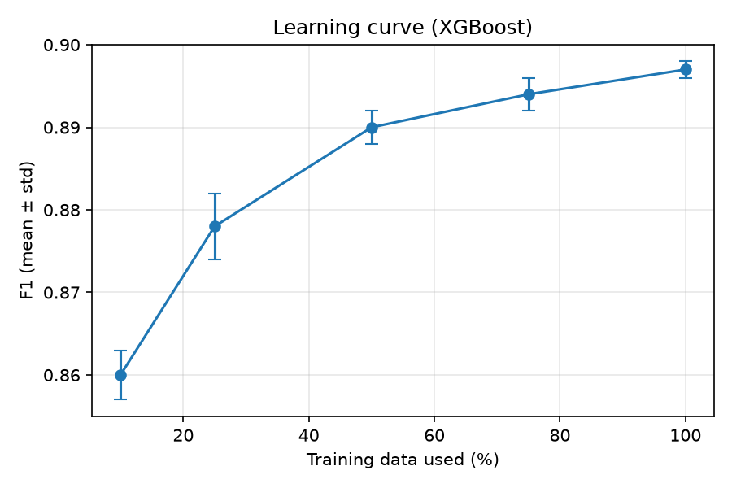
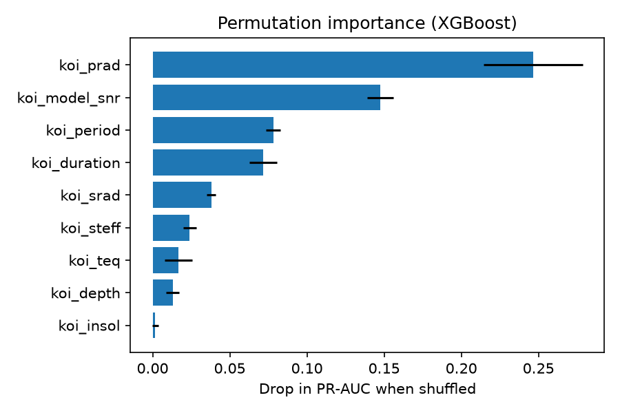
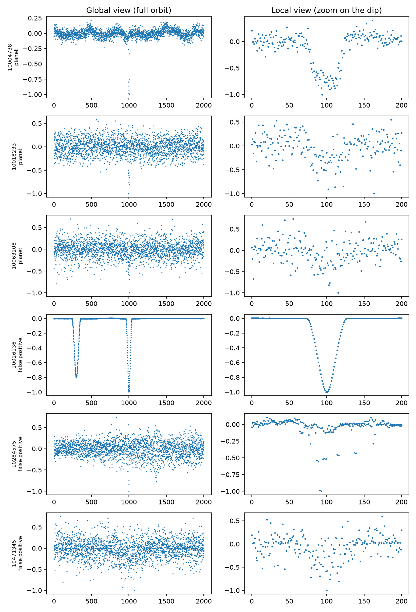
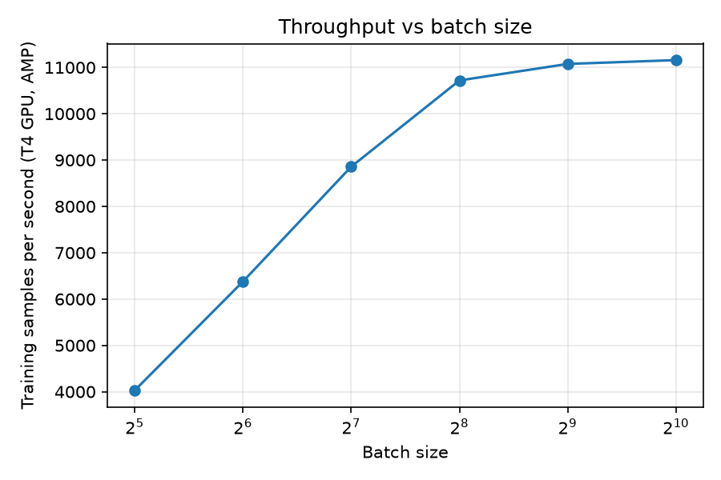

# Kepler Exoplanet Classifier

When NASA's Kepler telescope looks at stars, it spots thousands of tiny dips in brightness. Some of these are real exoplanets passing in front of their star, and plenty are false positives (eclipsing binary stars, noisy data and so on).

In this project I wanted to see how well we can tell them apart. I compared classic tabular models against a two-view 1D CNN trained directly on light curves. I also spent time seeing how fast I could push training on a GPU, and inference on CPU with ONNX.

## The short version

- **Tabular models are tough to beat.** Across 7,328 labeled Kepler Objects of Interest (KOIs), XGBoost gets an F1 of **0.897 ± 0.007** (PR-AUC 0.947) with star-grouped cross-validation.
- **Watch out for leakage.** If you add NASA's own vetting columns (`koi_score`, `koi_fpflag_*`), F1 jumps from 0.901 to **0.997**. Those columns basically give away the answer, so I left them out of every model.
- **CNN vs. XGBoost.** On the same 1,040 stars and the same folds, my 1D CNN (F1 0.70) clearly beats logistic regression (0.636) but still loses to XGBoost (0.818).
- **Speed-ups.** Training on a T4 GPU is **37x faster** than CPU, and **55x** with batch size 256, mixed precision and `torch.compile`. For CPU inference, ONNX Runtime ran about **3x faster** than PyTorch.

## 1. Tabular baselines

I kept only CONFIRMED (1) and FALSE POSITIVE (0) rows. `dropna()` removed 259 of 7,587 rows (3.4%), so I didn't impute.

So that the models can't memorize a particular star, I split by star (`StratifiedGroupKFold` on `kepid`) with 5 folds and 5 seeds. The models only see 9 features: `koi_period`, `koi_duration`, `koi_depth`, `koi_prad`, `koi_teq`, `koi_insol`, `koi_model_snr`, `koi_steff`, `koi_srad`.

| Model | Precision | Recall | F1 | PR-AUC | Precision@100 |
|:---|---:|---:|---:|---:|---:|
| Logistic regression | 0.720 | 0.802 | 0.759 ± 0.011 | 0.755 ± 0.023 | 0.799 |
| Random forest | 0.880 | 0.896 | 0.888 ± 0.008 | 0.943 ± 0.009 | 0.982 |
| XGBoost | 0.882 | 0.913 | 0.897 ± 0.007 | 0.947 ± 0.009 | 0.980 |

Random forest and XGBoost are tied within noise. Logistic regression is clearly behind.

### The leakage test

`koi_score` and the `koi_fpflag_*` columns come from the same NASA vetting process that produced the labels. Same XGBoost setup, same 6,625 rows, same folds:

| Setting | F1 | PR-AUC |
|:---|---:|---:|
| Without leak columns | 0.901 ± 0.010 | 0.950 ± 0.006 |
| With leak columns | 0.997 ± 0.002 | 0.999 ± 0.002 |

Getting 0.997 on noisy telescope data isn't a flex, it's a red flag.

### Learning curve (XGBoost, F1)

| Training data | 10% | 25% | 50% | 75% | 100% |
|:---|---:|---:|---:|---:|---:|
| F1 | 0.860 | 0.878 | 0.890 | 0.894 | 0.897 |

<p align="center">
  
</p>

The curve flattens after 50% of the data. More rows won't help much here, so the 9 features are the ceiling.

### What matters most (permutation importance)

Drop in PR-AUC when each feature is shuffled: `koi_prad` (0.247), `koi_model_snr` (0.147), `koi_period` (0.078), `koi_duration` (0.072), then `koi_srad`, `koi_steff`, `koi_teq`, `koi_depth`, and `koi_insol` at 0.002.

Physically this makes sense. A "planet" with a huge radius is probably a star, and a high signal-to-noise dip is much more convincing than a messy one. Depth, temperature and insolation score low, probably because they are derived from the other columns.

<p align="center">
  
</p>

## 2. Light-curve CNN

Next I wanted to see if a neural net could spot planets directly from the brightness curves. I downloaded Kepler long-cadence light curves for 1,040 stars (315 of them confirmed planets) with `lightkurve`.

For each star the pipeline flattens the curve (masking the transits first), removes outliers, folds it on the orbital period, and bins it into two views:

1. **Global view:** 2,001 bins covering the full orbit.
2. **Local view:** 201 bins zoomed in on the dip.

The network runs each view through its own 1D conv branch (BatchNorm, ReLU, max-pool), joins them, and sends them through dense layers. I trained it with class weights, augmentation (time flips, noise, small shifts) and early stopping on a validation split that is also split by star.

All three models below use the same 1,040 stars and the same folds. The two tabular models on this subset used median imputation for missing values (188 missing cells), not `dropna()`. The ± is the spread over all runs (the CNN has 25), and those runs are not independent, so it is not a strict error bar.

| Model | F1 | PR-AUC |
|:---|---:|---:|
| Logistic regression | 0.636 ± 0.061 | 0.659 ± 0.052 |
| CNN (5 seeds x 5 folds) | 0.701 ± 0.052 | 0.805 ± 0.045 |
| XGBoost | 0.818 ± 0.052 | 0.898 ± 0.041 |

The CNN did learn something real from the curve shapes, since it clears logistic regression by a good margin. But the tabular summary features carry a lot of signal, so XGBoost wins. With only about 830 training stars per fold, the CNN is data-limited. I left out Precision@100 here, because each test fold has only about 208 stars.

<p align="center">
  
</p>

### Error analysis

I looked at the 10 worst false positives and the 10 worst false negatives from the CNN (`results/errors_false_positives.png` and `results/errors_false_negatives.png`). The mistakes fall into a few groups.

- **Look-alike dips.** Many false positives show a clean, planet-shaped dip in the local view, so shape alone can't separate them from real planets (eclipsing binaries and contaminated stars can look the same).
- **Too little signal.** Several missed planets are mostly noise in both views, with a very shallow dip or none, and a few sit on strong stellar variability that hides the transit.
- **A preprocessing artifact.** For a few stars with very short transits, the local view has a straight line at the bottom, because empty bins are filled by linear interpolation. The model can mistake that line for a deep dip.
- **Surprising misses.** Two missed planets look like textbook clean transits, so the model is probably under-trained on the cleanest, deepest signals.

## 3. GPU engineering and benchmarking

I timed CNN training on Google Colab (Colab's CPU vs a T4 GPU, same data, 30 epochs timed) to see what actually helps:

| Setting | Sec / epoch | Samples / sec | vs CPU |
|:---|---:|---:|---:|
| CPU | 5.110 | 203.5 | 1x |
| GPU, batch 64 | 0.137 | 7,613.5 | 37x |
| + data preloaded on GPU | 0.137 | 7,565.4 | 37x |
| + AMP (batch 64) | 0.165 | 6,299.5 | 31x |
| GPU, batch 256 | 0.125 | 8,327.8 | 41x |
| + AMP (batch 256) | 0.095 | 10,961.4 | 54x |
| + `torch.compile` | 0.092 | 11,257.7 | 55x |

What I took from it:

- **Moving to the GPU is the big win** (37x right away).
- **Preloading did nothing.** The whole dataset is about 9 MB, so data transfer was never the bottleneck.
- **AMP was slower at small batches.** At batch 64 mixed precision hurt, and it only helped at batch 256. The model is small, so AMP's overhead costs more than it saves until each step has enough math.
- **`torch.compile` barely moved it** (about 3%, within noise).

Throughput by batch size (AMP, T4): 32 → 4,029, 64 → 6,379, 128 → 8,857, 256 → 10,719, 512 → 11,075, 1024 → 11,158 samples/s. It flattens out after 256.

<p align="center">
  
</p>

### Inference: PyTorch vs ONNX Runtime (CPU)

I used random weights and random inputs, since speed doesn't depend on the values. On those inputs both engines gave identical planet / not-planet calls, and the maximum absolute difference in the outputs was 2e-8.

| Engine | Batch | Latency | Samples / sec |
|:---|---:|---:|---:|
| PyTorch | 1 | 1.242 ms | 805 |
| ONNX Runtime | 1 | 0.388 ms | 2,575 |
| PyTorch | 256 | 145.7 ms | 1,758 |
| ONNX Runtime | 256 | 49.4 ms | 5,182 |

## 4. Ranking the unlabeled candidates

Finally, I trained XGBoost on all labeled rows (averaged over 5 seeds) and used it to rank the CANDIDATE KOIs. The list is in `results/candidates_ranked.csv`.

As a sanity check, the top 100 have an average `koi_score` of 0.911, against 0.800 across all candidates, even though the model never saw `koi_score` in training. The rank correlation over the whole candidate list is only 0.338.

This is a sanity check, not proof, because `koi_score` still comes from NASA's own pipeline. The output file has a `snapshot_date` column so I can check how my top picks hold up against future catalog updates.

## Project Structure

```
kepler-classifier/
├── notebooks/   # exploration and experiments
├── results/     # metrics, plots and candidate rankings
├── src/
│   ├── features.py   # feature preparation
│   ├── splits.py     # train/test splitting
│   ├── baseline.py   # tabular baseline model
│   └── train.py      # model training
├── requirements.txt
└── README.md
```

## How to run it yourself

```bash
pip install -r requirements.txt
python -m src.data               # research and download the KOI table
python -m src.baseline           # tabular baselines (results/baseline_table.csv)
python -m src.leakage            # leakage test
python -m src.learning_curve
python -m src.importance
python -m src.lightcurves        # download and process light curves (takes a while)
python -m src.train --name final --seeds 5   # CNN (use a GPU)
python -m src.compare            # same-data comparison
python -m src.error_analysis
python -m src.bench --name gpu --device cuda --preload --amp --batch 256
python -m src.export_onnx
python -m src.candidates
python -m pytest -q
```
##setup instructions:
## Setup

```bash
git clone https://github.com/ShreyaSingh0210/kepler-classifier.git
cd kepler-classifier
pip install -r requirements.txt
```

## Usage

```bash
python src/train.py
```

## Limitations and what's next

- **More light curves.** I only got 1,040 stars (I aimed for 2,000 to 3,000), which is why the CNN is data-limited. Scaling up the download is priority one.
- **Model fusion.** Since the CNN doesn't beat XGBoost alone, the next step is fusing the CNN embedding with the tabular features, plus proper tuning.
- **Multi-planet systems.** The light-curve dataset keeps one KOI row per star, so stars with several planets are only represented once.
- **Independent validation.** Checking against `koi_score` is useful, but comparing against newer confirmed-planet catalogs would be a much better test.
- **Interpolation artifact.** The local view fills empty bins by linear interpolation, which leaves straight lines for very short transits. Next step: mask the empty bins or use a wider local window.
- **Not done.** Profiler traces, TensorRT, cuML, and a custom GPU kernel for the fold-and-bin step.
  
## Results

| Model | Accuracy | Precision | Recall | F1 |
|-------|----------|-----------|--------|-----|
| Baseline | _fill in_ | _fill in_ | _fill in_ | _fill in_ |
| Light-curve CNN | _fill in_ | _fill in_ | _fill in_ | _fill in_ |

GPU vs CPU speedup: _fill in your measured value_
